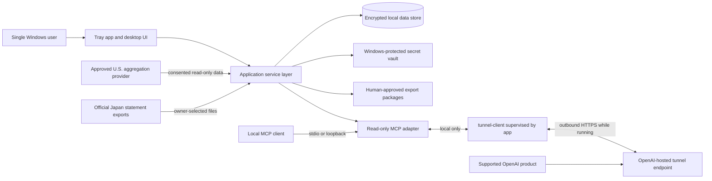

# Architecture

Status: proposed first-release architecture
Last reviewed: 2026-08-31

## Purpose and scope

Amex Local Finance Connector is a single-user, Windows 11-focused desktop application. It collects read-only American Express financial data, normalizes it into an owner-controlled local store, and exposes a deliberately small read-only MCP surface for financial questions.

The application is one connector with many account authorizations. It is not one connector installation per card, and it is not a cloud ledger. U.S. and Japan personal and company accounts can coexist on one installation while retaining their original authorization, legal entity, country, currency, account class, and business-purpose boundaries. This follows the observable MultiMCP-style topology: one connector/app, separately bound account authorizations, and an explicit account-or-portfolio target on every query; the design does not depend on undocumented proprietary behavior.

The first release has two access modes:

1. **Fully local mode.** The application, database, import/export workflows, and MCP server stay on the Windows computer. The MCP transport is stdio or a loopback-only HTTP listener. No tunnel is started.
2. **ChatGPT-connected private mode.** The tray application supervises OpenAI `tunnel-client`, which initiates an outbound HTTPS connection while the application is running and forwards requests to the local MCP server. The local server is never bound to a public interface and no inbound firewall port is opened.

OpenAI's official [Secure MCP Tunnel guide](https://developers.openai.com/api/docs/guides/secure-mcp-tunnels) describes this outbound-only private-server pattern and its runtime requirements. The general [MCP and Connectors guide](https://developers.openai.com/api/docs/guides/tools-connectors-mcp) describes remote MCP servers and connectors. These links are implementation references, not a promise that a particular OpenAI plan, organization, or workspace has tunnel access; availability and permissions must be verified for the intended deployment.

## Non-negotiable invariants

- Financial records, provider tokens, configuration, statement files, export packages, and audit logs are stored only on this Windows installation unless the owner explicitly copies an export or backup.
- There is no shared ledger, multi-user service, or cross-device synchronization.
- A portfolio is a local analytical view over selected accounts. It never merges or rewrites source transaction records.
- Every MCP call names an account or portfolio explicitly. There is no implicit “current,” “default,” or “all accounts” scope.
- Every target account is checked for authorization and data-readiness before a query runs. Reauthorization is requested only when refresh or recovery can no longer restore access.
- MCP has no financial or configuration mutation path. It cannot pay, transfer, control a card, open a dispute, post accounting entries, import statements, create exports, change mappings, acknowledge alerts, or reconfigure accounts.
- U.S. online collection uses a selected, approved consent-based aggregation/provider integration with read-only scope. The application never asks for or stores an Amex password.
- Japan collection in the first release accepts official Amex statement exports selected by the owner. It does not scrape Amex sites, automate a browser, or store Amex credentials.
- QuickBooks Online and Money Forward Cloud Accounting integration ends at a human-approved local export package. The application never posts that package to an accounting API.
- Fraud and anomaly findings are review aids, not determinations. They cannot block transactions or initiate a dispute.

## System context



The diagram shows a data path, not a data-residency guarantee for query results. When the owner enables ChatGPT-connected mode and invokes a tool, the selected financial data returned by that tool leaves the computer through the tunnel and is processed by the OpenAI product. Local-at-rest storage does not make those returned results local-only.

## Runtime components

### Tray host and desktop UI

The signed Windows desktop process starts in the system tray and owns application lifetime. Its UI provides:

- account consent and connection status;
- Japan statement import and validation review;
- account metadata, legal-entity mappings, and portfolio membership;
- category and business-purpose review;
- reconciliation and anomaly/fraud review queues;
- export preview and explicit approval;
- tunnel state, last-sync state, and audit-log inspection.

Renderer processes are treated as a lower-trust presentation tier. Context isolation, a narrow typed IPC bridge, no Node.js integration in renderers, a restrictive content security policy, and validated IPC inputs are release requirements. Privileged file, database, credential, network, export, and tunnel operations remain in the main/service process.

### Application service layer

Use-case services enforce policy before calling adapters. Important services are:

- **Account service:** manages local account identity, entity/classification metadata, authorization bindings, and status.
- **Authorization service:** owns U.S. provider consent state, token refresh, revocation detection, and reauthorization state transitions.
- **Import service:** parses supported official statement exports in an isolated staging workflow.
- **Normalization service:** converts provider/file records into immutable source-scoped statements and transactions.
- **Reconciliation service:** compares statement boundaries, balances, totals, and row-level completeness.
- **Classification service:** applies versioned category mappings and records owner overrides without destroying source descriptions.
- **Portfolio service:** computes owner-selected cross-account reports while preserving source attribution.
- **Anomaly service:** creates review-only alerts with explainable evidence.
- **Export service:** previews mappings, detects duplicates, records approval, and atomically materializes packages.
- **MCP query service:** exposes only read models and cannot reference command-side adapters.
- **Audit service:** appends security and business-process events with sensitive-value redaction.

### Local persistence and secret handling

The production store is an encrypted local database in the current Windows user's application-data directory. Database keys are generated locally and wrapped using Windows user-bound protection (for example DPAPI through a reviewed library); OAuth refresh tokens, tunnel runtime credentials, and similar high-value secrets are held in a Windows-protected credential vault or encrypted secret records referenced by opaque IDs. Secret material is never placed in `.env`, ordinary configuration JSON, logs, audit payloads, crash reports, or the database in plaintext.

The implementation may begin with an in-memory or demo database, but real provider tokens or real statements must not be used until authenticated encryption, key lifecycle, migration, backup, and recovery controls pass the security gates in `IMPLEMENTATION_PLAN.md`.

Recommended persistence separation:

- one installation database, owned by one Windows user;
- account-scoped rows with non-null `account_id` on every financial fact;
- separate authorization records and secret references for each individually authorized connection/account binding;
- append-only import, sync, reconciliation, export, and audit records;
- derived portfolio/report tables or views that reference source rows rather than copying them into a shared ledger.

### U.S. provider adapter

The adapter interface is provider-neutral. A provider cannot be enabled until commercial approval, supported account coverage, read-only scopes, token handling, webhook/polling behavior, data retention, and incident obligations are reviewed.

Consent launches the provider's authorization experience in the system browser or approved embedded flow. OAuth/OIDC defenses such as state, nonce where applicable, PKCE where supported/required, exact redirect matching, and TLS validation are mandatory. The application never collects an Amex username or password. Provider credentials are isolated per authorization; one failed or revoked consent does not invalidate unrelated accounts.

### Japan statement adapter

The first release supports owner-selected official CSV, Excel, QIF, and PDF statement exports only after each concrete format variant has a fixture-backed parser. The adapter validates file type and limits, extracts data into a staging model, shows validation and reconciliation results, then requires owner confirmation before committing normalized rows. No website scraping, browser automation, or credential capture is permitted.

### Read-only MCP adapter

The MCP adapter depends on query interfaces only. It exports exactly the tools specified in `MCP_TOOLS.md`:

- `list_accounts`
- `get_account_status`
- `list_transactions`
- `get_statement`
- `get_portfolio_report`
- `list_fraud_alerts`
- `explain_alert`

All tools are declared read-only and are also enforced read-only in code. Tool annotations are defense-in-depth metadata, not the authorization boundary. The adapter has no dependency on account configuration, consent launch, import, export, payment, dispute, card-control, or accounting-posting commands.

Appending a redacted tool-access audit event and operational metrics does not change financial data or configuration and is the only intentional local write caused by an MCP query.

### Tunnel supervisor

The tunnel supervisor is optional and off by default until configured. When enabled, it:

1. verifies the MCP server is bound to stdio or loopback only;
2. obtains the `tunnel_id` and runtime credential by secret reference;
3. starts the pinned, integrity-checked OpenAI `tunnel-client` as a child process;
4. monitors health and exposes state in the tray;
5. redacts child-process output before logging;
6. terminates the child on application exit, user disablement, Windows session lock if configured, or repeated security-significant failures.

The OpenAI guide states that `tunnel-client` initiates outbound HTTPS and forwards work to a locally reachable MCP server. The configured OpenAI-hosted endpoint may continue to exist when the desktop app is stopped, but it cannot reach this installation without the running client. “Available only while the app runs” therefore means the local forwarding client and MCP service are not running; it does not imply automatic deletion of the Platform tunnel configuration.

The application must not substitute a generic public reverse proxy, public port-forward, or public MCP deployment. If Secure MCP Tunnel is unavailable to the user's OpenAI context, connected mode is unavailable and fully local mode remains functional.

## Account, authorization, and portfolio boundaries

### One connector, many authorization contexts

The connector is installed once. Each U.S. consent is represented by an `AuthorizationGrant`, and each discovered account is bound explicitly to the grant that can read it. If a provider consent covers multiple provider-side card accounts, the application still creates distinct local accounts and account bindings; it never treats grant identity as account identity.

Japan import-only accounts have no online authorization grant. Their readiness is based on local configuration and successful import state.

### Authorization state machine

```text
unconfigured -> authorizing -> ready
authorizing  -> authorization_failed
ready        -> refreshing -> ready
ready        -> temporarily_unavailable
refreshing   -> reauthorization_required
ready        -> reauthorization_required   (revoked/invalid grant)
reauthorization_required -> authorizing     (owner action in UI only)
any online state -> disconnected            (owner action in UI only)
```

Transient network/provider errors use retry/backoff and do not trigger reauthorization. `reauthorization_required` is entered only for an explicit revocation, an invalid/expired grant that cannot be refreshed, an account-consent mismatch, or another provider response that requires fresh owner consent. MCP calls report this state but never launch authorization.

Import-only accounts use `import_ready`, `import_stale`, `import_error`, and `disconnected`; they never report an OAuth reauthorization requirement.

### Target resolution

Every MCP request carries a discriminated `target` containing either one opaque local `account_id` or one opaque local `portfolio_id`. The query layer resolves the target within this installation and applies account predicates before reading facts. It rejects unknown, disabled, mismatched, or out-of-scope IDs without revealing whether another account exists.

A portfolio is an owner-curated membership table. Portfolio reports union authorized queries at calculation time and emit source attribution on every item or aggregate group. Portfolio membership grants no new provider access and cannot bypass an account's authorization/readiness state.

## Main data flows

### U.S. consent and sync

1. Owner creates a connection from the desktop UI and selects the legal entity/account class metadata.
2. Authorization service creates a correlation record and launches the approved provider consent flow.
3. Callback state is validated; tokens are stored only in the protected vault.
4. Provider accounts are discovered and the owner confirms local account mappings.
5. Sync fetches read-only statements/transactions, stages them, validates schemas and account binding, deduplicates, and commits atomically.
6. Reconciliation and derived category/alert jobs run against committed source-scoped records.
7. Audit events record consent, sync outcome, and mapping changes without tokens or full financial payloads.

### Japan import

1. Owner chooses an official export file and a destination account.
2. Import service hashes and stages the file, validates its type/limits, and selects a versioned parser.
3. Parsed rows retain raw source values alongside normalized values.
4. Account/currency/date/total checks and duplicate detection produce a review report.
5. Owner confirms the import; the service commits an `ImportBatch`, statement, and transactions atomically.
6. The raw file is retained or securely deleted according to the configured local policy; either choice is explicit in the UI and audit log.

### MCP query

1. MCP transport authenticates/accepts a request from the configured local client or active private tunnel.
2. Schema validation requires a target and bounded query parameters.
3. Target resolver loads the exact account/portfolio membership.
4. Authorization/readiness checks run for every included account.
5. Query service reads a consistent local snapshot and enforces row-level account predicates.
6. Response includes freshness, provenance, currency, partial-result warnings if explicitly allowed, and pagination metadata.
7. Audit service appends a redacted event containing tool name, target hash, result count, and outcome.

No live provider fetch is initiated by an MCP call. Sync is a desktop-owned operation. This prevents an apparently read-only question from causing consent, provider side effects, or unbounded latency.

### Export

1. Owner chooses an account/entity-specific export profile in the desktop UI.
2. Export service builds an in-memory preview and validation report.
3. Duplicate detection checks source facts, prior committed imports, and prior local export manifests.
4. Owner reviews warnings and gives explicit approval for the exact batch digest.
5. Only then does the service materialize an atomic local package and append an audit event.

No MCP tool can enter this flow, and no component sends the package to QuickBooks or Money Forward.

## Consistency, reconciliation, and derived data

- Source statements and transactions are immutable after commit. Corrections are modeled as superseding imports/provider versions with lineage.
- Deduplication identifies candidates; ambiguous matches require review and are never silently discarded.
- Reconciliation records the statement opening/closing balance, sum of activity, currency, parser/provider version, tolerance, and outcome.
- Categories and business-purpose classifications are versioned assignments. The original merchant text and source category remain intact.
- Original amounts/currencies are canonical. Converted totals are derived using a named FX rate, rate date, quote/base currency, precision, and retrieval time.
- Cross-currency totals are not presented without an explicit reporting currency and FX provenance.
- Anomaly/fraud alerts store features and reason codes sufficient for review. Alert status changes happen only in the UI; MCP explanation is side-effect free.

## Failure and recovery behavior

- A failed import or sync does not expose partial rows; staging is discarded or retained as a failed batch without joining the queryable facts.
- A database migration uses an encrypted backup/checkpoint and transactional version change. Recovery never uploads data.
- A provider outage marks data stale/temporarily unavailable and preserves last successful data; it does not force reauthorization.
- A portfolio query defaults to complete-or-error. Callers may explicitly allow partial data, in which case missing accounts and freshness are returned without leaking unrelated account details.
- Tunnel failure changes connectivity state and stops accepting remote work; local UI/import/export and local MCP remain usable.
- Export materialization writes to a temporary file in the chosen destination and atomically renames after checksums pass. Failed packages are not recorded as successful.

## Operational boundaries

### Logging and audit

Application logs are local, size-bounded, and redacted. Audit events capture who/what/when/outcome for consent, sync, import, mapping, alert review, export approval/materialization, MCP reads, security settings, and tunnel lifecycle. They exclude secrets, complete account numbers, full transaction payloads, raw statements, and unredacted provider errors.

The audit chain can provide tamper evidence against ordinary accidental modification, but a local administrator or malware controlling the user session can rewrite both data and verification state. It is not a remote, independently anchored compliance ledger.

### Backups and deletion

There is no automatic cloud backup or sync. Any backup is owner-initiated, encrypted, local/removable-media focused, and documented with recovery testing. Account disconnect stops future collection but does not silently erase historical records. Deletion is a separate destructive UI workflow with a preview of affected local data, export history, imports, and secret references.

### Updates and installer

The Windows installer is built for Windows 11 x64 first. Release artifacts should be code-signed, checksummed, reproducible where practical, dependency-scanned, and tested for install, upgrade, rollback failure, and uninstall data-retention behavior. Automatic updating, if later enabled, must not transmit financial data and must verify signed metadata and binaries.

## Explicitly out of scope

- Payments, transfers, cash advances, or bill pay.
- Card activation, freeze/unfreeze, limit changes, PIN, authorized-user, or reward controls.
- Dispute or chargeback initiation, merchant contact, or fraud reporting.
- Accounting-system APIs, automatic journal posting, or unattended export creation.
- Browser scraping, credential replay, or storing Amex passwords.
- Shared/team access, remote administration, a hosted ledger, or device synchronization.
- Tax, legal, investment, credit, or fraud-guarantee advice.
- Treating imported, provider, categorized, converted, or anomaly-scored data as authoritative without reconciliation and owner review.

## References and review cadence

- [OpenAI: Secure MCP Tunnel](https://developers.openai.com/api/docs/guides/secure-mcp-tunnels)
- [OpenAI: MCP and Connectors](https://developers.openai.com/api/docs/guides/tools-connectors-mcp)

Recheck these official references before implementing or releasing connected mode because product availability, permission models, client configuration, and network requirements can change. Record the verified date and tunnel-client version in the release evidence.
