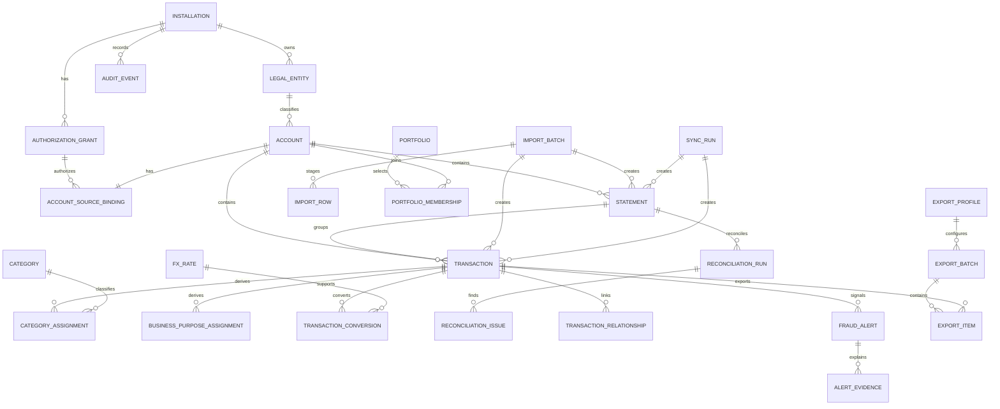

# Data Model

Status: normative conceptual model
Storage: one encrypted local database per Windows installation/user

## Model goals

- Keep every financial fact bound to exactly one source account.
- Support many independently authorized U.S. accounts and many import-only Japan accounts in one connector installation.
- Retain legal entity, country, currency, account class, business purpose, statement, and collection lineage.
- Make a portfolio an owner-controlled local view, not a merged/shared ledger.
- Preserve immutable source facts while versioning corrections, categories, FX, duplicate decisions, reconciliations, alerts, and exports.
- Keep secrets out of the ordinary relational model; store only opaque references to the Windows-protected vault.
- Represent money, time, status, and provenance without floating-point or locale ambiguity.

Names below are conceptual snake-case table names. Physical schema migrations may refine indexes/constraints but must preserve these invariants.

## High-level relationships



## Common scalar rules

### Identifiers

- Primary keys are opaque, locally generated IDs (UUIDv7 or another reviewed collision-resistant local scheme) serialized as strings.
- IDs carry no account number, provider ID, entity name, country, or authorization meaning.
- Provider/source identifiers are separate protected fields. MCP never accepts or returns them.
- Foreign keys are enabled and checked in every connection; application code cannot disable them.

### Instants and calendar dates

- `*_at` means an RFC 3339/UTC instant persisted in a lossless database representation.
- `*_date` means an ISO calendar date with separately recorded source/reporting time zone when needed.
- Preserve original provider/file date text in protected lineage for parser audits.
- Store `source_time_zone`/offset and date semantics (transaction date, posted date, statement date) rather than guessing from the Windows zone.
- Timeouts use monotonic clocks at runtime; audit/provider instants also record detected significant wall-clock changes.

### Money

Canonical source money uses:

```text
currency             uppercase ISO 4217 code
currency_exponent    validated exponent used for this record
amount_minor         non-negative exact integer
direction            debit | credit
```

For owner cash-flow display, debit/charge/outflow becomes negative and credit/payment/refund/inflow becomes positive. Direction remains explicit.

Requirements:

- Never use binary floating point for stored amounts, totals, rates, duplicate comparisons, or exports.
- Persist minor units as an exact signed-64-capable integer representation; drivers must return it as BigInt/string without passing through an unsafe JavaScript number. If the selected driver cannot guarantee that, use a checked canonical integer string plus exact-decimal application aggregation and record that decision.
- FX rates and computed high-precision intermediates are canonical decimal strings with defined precision/rounding, never `REAL`.
- Preserve raw source amount/sign/type in encrypted lineage.
- A statement/account currency mismatch is an issue, not an implicit conversion.

### Enumerations and status

Persist explicit validated strings with database checks/reference tables. Unknown external values are stored in protected raw lineage and map to an `unknown`/review state; they do not bypass validation. State transitions occur through domain commands, not arbitrary update objects.

### Sensitive text

Descriptions, merchants, filenames, memo fields, categories, PDF text, and provider errors are untrusted strings. Store normalized search text separately from original text. Apply size limits and safe rendering; never interpret these values as HTML, Markdown instructions, file paths, SQL, or commands.

## Installation and configuration entities

### `installation`

One row for the local installation.

| Field | Notes |
| --- | --- |
| `installation_id` | Opaque local ID; not a cloud identity. |
| `schema_version` | Current migration version. |
| `created_at`, `updated_at` | UTC instants. |
| `display_locale`, `time_zone` | Presentation defaults only; never rewrite source dates. |
| `data_retention_policy_version` | Reference to owner-reviewed local policy. |
| `audit_chain_head` | Latest expected audit digest/sequence; tamper evidence only. |

There is no remote-user ID, sync tenant, shared-ledger ID, or device replication cursor.

### `legal_entity`

Represents the person or company to which an account belongs.

| Field | Notes |
| --- | --- |
| `legal_entity_id` | Opaque local ID. |
| `entity_type` | `individual` or `company`. |
| `display_name` | Owner-entered; sensitive. |
| `country` | Primary legal/owner context, not a tax determination. |
| `enabled` | Configuration state. |
| `created_at`, `updated_at` | Audited. |

Tax identifiers, registration numbers, and addresses are not required for 1.0 and should not be stored without a defined export need and additional controls.

### `account`

One local financial account/card account. Multiple cards returned under one provider grant remain separate rows.

| Field | Notes |
| --- | --- |
| `account_id` | Opaque local ID. |
| `legal_entity_id` | Required. |
| `display_name` | Owner-defined. |
| `masked_identifier` | Last four or safer mask only; never full PAN. |
| `country` | `US` or `JP` in 1.0. |
| `currency` | Primary/source currency. |
| `account_class` | `personal` or `company`. |
| `source_kind` | `us_provider` or `jp_statement_import`. |
| `business_purpose_default` | Nullable suggestion, not a transaction fact. |
| `enabled` | Owner configuration state. |
| `preferred_freshness_seconds` | Nullable policy for status/query warnings. |
| `created_at`, `updated_at`, `disconnected_at` | Lifecycle. |

Changing entity/country/classification creates audited configuration history. Existing transactions retain their collection-time snapshots.

### `account_configuration_version`

Immutable history of material account metadata used by imports, reports, and exports.

Fields: `account_configuration_version_id`, `account_id`, entity/country/currency/class/default-purpose snapshot, effective/created instants, actor (`owner`/migration), reason, and superseded version link.

## Authorization and source binding

### `authorization_grant`

Represents one independently consented U.S. provider authorization. It is not an account.

| Field | Notes |
| --- | --- |
| `authorization_grant_id` | Opaque local ID. |
| `provider_key` | Allowlisted adapter identifier/version family. |
| `provider_subject_hash` | Optional keyed hash for correlation; no raw customer identity unless required. |
| `state` | `authorizing`, `ready`, `refreshing`, `temporarily_unavailable`, `reauthorization_required`, `authorization_failed`, `disconnected`. |
| `scope_set` | Validated normalized read-only scopes; no token. |
| `secret_ref` | Opaque reference to vault-held token set. |
| `authorized_at`, `last_checked_at`, `expires_at`, `revoked_at` | Lifecycle metadata. |
| `reauthorization_reason_code` | Safe enum, not raw provider error. |
| `last_error_code` | Redacted normalized code. |

No access token, refresh token, client secret, cookie, password, security answer, or authorization header belongs in this table, logs, or audit payloads.

### `account_source_binding`

Binds one account to exactly one collection identity.

| Field | Notes |
| --- | --- |
| `account_source_binding_id` | Opaque local ID. |
| `account_id` | Unique, required. |
| `authorization_grant_id` | Required for `us_provider`; null for `jp_statement_import`. |
| `provider_account_ref` | Encrypted provider identifier or vault/protected-data reference. |
| `provider_account_ref_hash` | Keyed hash for uniqueness/comparison without display. |
| `import_account_mask` | Masked expected Japan statement identifier, nullable. |
| `binding_state` | `pending_confirmation`, `active`, `mismatch`, `disabled`. |
| `confirmed_at` | Owner confirmation for discovery/import binding. |

Constraints enforce source-kind/grant consistency. A provider response cannot be committed until grant and provider-account reference match this binding.

### `source_checkpoint`

Provider incremental cursor/checkpoint scoped to one `account_source_binding`, encrypted when sensitive. It advances only in the same transaction that commits the corresponding successful staged data. A failed/partial sync cannot skip records by advancing early.

## Portfolio entities

### `portfolio`

| Field | Notes |
| --- | --- |
| `portfolio_id` | Opaque local ID. |
| `display_name` | Owner-defined. |
| `reporting_currency_default` | Nullable convenience; every MCP report still supplies currency explicitly. |
| `enabled` | Configuration state. |
| `created_at`, `updated_at` | Audited. |

### `portfolio_membership`

| Field | Notes |
| --- | --- |
| `portfolio_membership_id` | Opaque local ID. |
| `portfolio_id`, `account_id` | Unique current pair. |
| `display_order` | Owner-defined. |
| `included_at`, `removed_at` | History/effective range. |
| `membership_version` | Monotonic version for query snapshots/cursors. |

This table grants no provider authorization. It contains no balance, journal entry, or copied transaction. Portfolio queries resolve a membership snapshot, then query account-scoped facts and preserve contributing account IDs.

## Collection lineage

### `import_batch`

One owner-selected Japan statement file attempt.

| Field | Notes |
| --- | --- |
| `import_batch_id` | Opaque local ID. |
| `account_id` | Selected before parsing; required. |
| `file_sha256`, `file_size`, `detected_type` | Identity/validation. |
| `original_filename_display` | Sanitized base name only. |
| `parser_id`, `parser_version` | Exact adapter lineage. |
| `state` | `staged`, `parsed`, `validated`, `awaiting_review`, `committed`, `failed`, `rejected`. |
| `approval_digest`, `approved_at` | Owner confirmation bound to immutable plan. |
| `row/page/count/totals` | Validation summary by currency/direction. |
| `raw_retention` | `purged` or `retained_encrypted`. |
| `created_at`, `committed_at` | Lifecycle. |

`file_sha256 + account_id + parser_id/version` participates in idempotency, but a parser upgrade must not silently reinterpret a committed batch.

### `import_row`

Staging/lineage record scoped to one batch.

Fields: `import_row_id`, `import_batch_id`, source locator (sheet/row, QIF record, PDF page/line), encrypted/bounded raw values or protected blob reference, normalized candidate fields, validation state/issues, fingerprint, and resulting `transaction_id`/`statement_id` after commit.

Staging rows are not queryable financial facts. Retention is minimized after commit according to the raw-data policy.

### `sync_run`

One bounded provider collection attempt, scoped to one grant and optionally one account.

Fields: `sync_run_id`, `authorization_grant_id`, requested account set, provider adapter/version, start/end instants, state (`running`, `success`, `partial`, `failed`, `cancelled`), normalized error/rate-limit data, prior/new checkpoint references, received/staged/committed/rejected counts, and data-as-of.

Provider payloads and authorization headers are not audit/log fields. Protected minimal lineage is retained only when needed for reconciliation/support and under retention policy.

### `source_record`

Optional common lineage wrapper for an immutable provider record or committed import row.

Fields: `source_record_id`, source kind, account binding, import/sync lineage, protected external reference, keyed reference hash, content digest, collected time, source version/status, and optional encrypted minimal raw payload reference.

The unique key is source-kind/account-binding/external-reference/version, never external reference globally.

## Financial facts

### `statement`

Immutable normalized statement version.

| Field | Notes |
| --- | --- |
| `statement_id` | Opaque local ID. |
| `account_id` | Required source scope. |
| `source_record_id` | Required lineage when available. |
| `import_batch_id` / `sync_run_id` | Exactly one collection lineage path. |
| `period_start_date`, `period_end_date` | Required and ordered. |
| `issue_date`, `due_date` | Nullable source dates. |
| `currency`, `currency_exponent` | Required. |
| opening/closing/payment-due money fields | Nullable exact minor units/directions as semantically applicable. |
| `source_version`, `record_state` | `current`, `superseded`, `voided` with lineage. |
| `collected_at`, `data_as_of` | Freshness. |
| configuration snapshot fields | entity/country/account-class/binding version at collection. |

At most one non-superseded current statement exists per account/source statement identity/version rules. Corrections link with `supersedes_statement_id`.

### `transaction`

Immutable normalized transaction version.

| Field | Notes |
| --- | --- |
| `transaction_id` | Opaque local ID. |
| `account_id` | Required, never inferred through statement alone. |
| `statement_id` | Nullable for pending/unassigned; if present, same account enforced. |
| `source_record_id` | Required lineage. |
| `import_batch_id` / `sync_run_id` | Exactly one collection lineage path. |
| `transaction_date`, `posted_at` | Source-semantic date/instant. |
| `status` | `pending`, `posted`, `superseded`, `voided`. |
| `currency`, `currency_exponent`, `amount_minor`, `direction` | Exact original normalized money. |
| `description_original`, `merchant_original` | Bounded untrusted source text. |
| `description_search`, `merchant_search` | Deterministic normalized search values. |
| `source_category` | Nullable source hint. |
| `provider_reference_hash` | Nullable keyed hash; never MCP output. |
| `collected_at`, `data_as_of` | Freshness. |
| `legal_entity_id_snapshot` | Required collection-time entity. |
| `country_snapshot`, `account_class_snapshot` | Required. |
| `account_configuration_version_id` | Required. |

Business-purpose/category values are versioned assignments below, but the current read model must always return their value/review state. The source transaction row is never updated to “reclassify” it.

### `transaction_relationship`

Represents reversible lineage/duplicate relationships without deleting either fact.

Fields: `transaction_relationship_id`, left/right transaction IDs (same account unless an explicitly reviewed cross-source-link case), type (`exact_duplicate`, `possible_duplicate`, `pending_to_posted`, `supersedes`, `reversal`), evidence/version/score, decision (`automatic_exact`, `owner_confirmed`, `owner_rejected`, `needs_review`), creator, and time.

Possible duplicates do not become exact solely because the score is high.

## Reconciliation

### `reconciliation_run`

Immutable computation for one statement/version.

Fields: `reconciliation_run_id`, `statement_id`, algorithm/version, input snapshot digest, opening/closing/reported activity totals, computed totals by direction/type, transaction/skipped/quarantined counts, currency/tolerance, difference, status (`reconciled`, `warning`, `failed`, `not_applicable`), run time, and superseded run link.

### `reconciliation_issue`

Fields: `reconciliation_issue_id`, run ID, safe issue code, severity, statement/transaction/import-row reference, expected/observed structured values, review state, owner note, created/resolved times.

The current reconciliation view is the latest non-superseded run; history remains.

## Classification and business purpose

### `category`

Owner-controlled hierarchy: `category_id`, parent ID, display name, active state, and timestamps. Categories contain no accounting-target credentials.

### `category_rule`

Immutable/versioned rule with scope (`installation`, entity, account), matcher type/value, precedence, category result, active/effective range, creator, and version. Rule evaluation is deterministic and records the matched rule.

### `category_assignment`

Fields: `category_assignment_id`, `transaction_id`, `category_id` nullable/unclassified, source (`provider_hint`, `rule`, `owner`), rule/version reference, confidence/review state, effective/created time, and superseded assignment. One current assignment per transaction.

### `business_purpose_assignment`

Fields: `business_purpose_assignment_id`, `transaction_id`, normalized owner-defined purpose or nullable, source (`account_suggestion`, `rule`, `owner`), review state (`unreviewed`, `suggested`, `confirmed`), rule/version reference, timestamps, and superseded assignment. One current assignment per transaction.

An account default is stored as a suggestion assignment, not copied as an owner-confirmed fact.

## FX and portfolio derivations

### `fx_rate`

| Field | Notes |
| --- | --- |
| `fx_rate_id` | Opaque local ID. |
| `base_currency`, `quote_currency` | Ordered pair. |
| `rate_decimal` | Canonical positive decimal string. |
| `rate_date`, `source_time_zone` | Policy date. |
| `source_key`, `source_version` | Provenance, not a secret. |
| `retrieved_at`, `validity_state` | Freshness/review. |
| `input_digest` | Owner-imported/source payload lineage where applicable. |

### `transaction_conversion`

Fields: `transaction_conversion_id`, transaction ID, reporting currency, FX rate ID, conversion policy/version, converted exact minor units, rounding mode, computed time, and superseded conversion. One current conversion per transaction/reporting-currency/policy version.

Portfolio totals are preferably computed read models keyed by portfolio membership version, source snapshot, report period, reporting currency, and FX policy. Any cache is disposable derived data and retains contributing account IDs; it is never a ledger/journal table.

## Fraud/anomaly review

### `fraud_alert`

Local review signal, not an issuer fraud record.

Fields: `alert_id`, account ID, nullable transaction ID, detected time, severity, title/reason codes, rule/model version, input snapshot digest, review state (`open`, `reviewed`, `dismissed`), `review_only = true`, and superseded alert link.

Titles must not assert fraud. A uniqueness/idempotency key prevents repeated runs of the same model/input from spamming duplicate alerts.

### `alert_evidence`

Fields: `alert_evidence_id`, alert ID, reason code, bounded factual observation, bounded baseline/comparison, contribution level, feature/version, and provenance. Evidence does not contain executable instructions or full unrelated transaction history.

### `alert_review_event`

Append-only UI action: alert ID, prior/new state, owner note, timestamp, and audit correlation. MCP explanation creates no review event.

## Accounting export history

### `export_profile`

Versioned per-account/legal-entity configuration.

Fields: `export_profile_id`, account ID, legal entity ID, target family (`quickbooks_online`, `money_forward_cloud`), target format/version, masked target identifiers, mapping-policy reference/version, currency/sign/date/encoding/delimiter/newline/formula-safety rules, active/effective range, and created/updated audit correlation.

Sensitive target credentials are not needed because 1.0 never posts. If a target identifier is sensitive, store it encrypted and expose a mask.

### `export_batch`

| Field | Notes |
| --- | --- |
| `export_batch_id` | Opaque local ID. |
| `export_profile_id`, profile version | Exact mapping. |
| source snapshot/membership version | Immutable selection basis. |
| selection/period/filter digest | Reproducibility. |
| `state` | `draft`, `preview_validated`, `awaiting_approval`, `approved`, `materializing`, `created`, `invalidated`, `failed`, `superseded`. |
| counts/totals/warnings | Preview summary by currency/direction. |
| duplicate decision digest | Exact decisions. |
| `approval_digest`, `approved_at` | Required before any file. |
| encoding/format/version | Exact bytes contract. |
| package/file checksums | Present only after creation. |
| created/superseded times | Lifecycle. |

There is deliberately no `posted_at` or remote target response. Optional owner notes may say manually imported, but are not verified target state.

### `export_item`

Fields: export batch ID, transaction ID and immutable source version, include/exclude decision, duplicate status/decision, mapped target fields digest, stable import identifier where supported, validation issues, and output row/record index after creation.

The batch transaction selection must be unique. A prior batch match produces a warning/decision, not an automatic claim about the unconnected target ledger.

## Audit

### `audit_event`

Append-only application event with:

- monotonic local sequence and event ID;
- UTC time and detected clock-change marker;
- actor kind (`owner_ui`, `system`, `mcp_local`, `mcp_tunnel`, `migration`);
- action, outcome, safe reason code, and correlation/request ID;
- hashed/pseudonymous target/account/grant/batch references where possible;
- allowlisted structured metadata such as counts, versions, state transition, and digest;
- prior-event hash and current-event hash.

Never include tokens, secrets, authorization headers, provider payloads/errors, full account numbers, raw statement text, full transaction records, raw filenames/paths, or export rows.

The hash chain detects ordinary discontinuity but is not a trusted remote ledger. A local administrator controlling the application, database, and chain head can forge it.

## Required database invariants

1. Every statement/transaction has a non-null account ID and collection-time entity/country/class snapshots.
2. A transaction's statement, if present, belongs to the same account.
3. Every committed statement/transaction has exactly one valid source lineage path and a source binding matching its account.
4. U.S. accounts have a binding to an authorization grant; Japan import-only accounts do not.
5. No authorization token, password, tunnel key, database key, or secret plaintext is a relational field.
6. A portfolio contains memberships only; no transaction/balance/journal row points to a portfolio as its source.
7. Original money/currency/direction and description are immutable; derived conversions/classifications are separate versioned rows.
8. No cross-currency total exists without reporting currency and FX provenance; missing FX cannot become zero.
9. Possible duplicates preserve both records and an explicit decision state.
10. Provider checkpoint advancement and staged-data commit are atomic.
11. An import batch cannot be committed without a matching content/validation approval digest.
12. An export cannot materialize a file before a valid approval digest, and any material input change invalidates approval.
13. Alert rows are review-only and cannot carry a command/action reference.
14. Account disconnect/revocation changes future collection/readiness but does not silently delete history.
15. All material configuration, consent, collection, reconciliation, review, export, tunnel, migration, and deletion actions append a redacted audit event.

## Query isolation

The query layer never runs “all transactions” and filters afterward. It receives a prevalidated non-empty allowed-account ID set:

- account target: exactly one resolved account ID;
- portfolio target: exactly the current membership snapshot ID set.

Every statement, transaction, derivation, alert, and export-history query includes an account predicate or joins through a fact already constrained by that set. Cursors are bound to target and membership/source snapshot. Unknown/out-of-scope IDs yield the same safe not-found behavior.

Recommended indexes include account plus date/status/current-version keys, statement/account/period, source-binding/external-reference hash, import digest/account, portfolio/current membership, transaction/current assignments, alert/account/detected date, and export-profile/prior items. Index contents are encrypted with the database and do not weaken account predicates.

## Mutation and concurrency model

- One local command writer serializes migrations, imports, sync commits, configuration, alert review, and export materialization.
- UI and MCP queries use consistent read snapshots; an MCP call never upgrades to a write transaction.
- Long parsing/provider fetch occurs outside the write transaction in private staging. Final validation and commit are short and atomic.
- Optimistic version/digest checks prevent stale UI approval and portfolio/configuration lost updates.
- Process crashes leave a recoverable staging/batch state, not partially visible facts.

## Retention, disconnect, deletion, and backup

- **Disconnect/revoke:** removes/invalidates future secret access and source collection; historical local facts remain until separately deleted.
- **Raw staging:** purged or retained encrypted under the explicit policy; failed staging has a short bounded cleanup period.
- **Provider minimal raw lineage:** retain only fields required for reconciliation, versioning, and support, under a documented period.
- **Exports:** package files are owner-controlled; local manifests remain for duplicate warnings until the owner deletes them through a disclosed workflow.
- **Logs/audit:** bounded local retention; audit integrity behavior across rotation is documented.
- **Account deletion:** preview affected statements, transactions, derivations, alerts, memberships, export history, raw imports, and secrets. Revoke/clean secret refs, then perform a transactional local deletion/pseudonymization policy. Do not silently affect other grants/accounts.
- **Backup:** owner-initiated, encrypted, includes schema/key recovery metadata without exporting plaintext secrets, and has tested same-user recovery. There is no automatic cloud/cross-device replication.

Deletion cannot guarantee removal from filesystem snapshots, SSD remanence, external backups, copied exports/imports, OpenAI conversations, provider systems, or accounting products. The UI must state those boundaries.

## Migration and compatibility rules

- Every schema change has a forward migration, integrity precheck, encrypted checkpoint/backup, transaction boundary, and post-migration verification.
- Destructive/semantic migrations require explicit source/derivation lineage preservation and rollback/recovery testing.
- Money sign, currency exponent, ID scope, account binding, target predicates, source lineage, and approval-digest semantics cannot change implicitly.
- Parser/provider/model/export profile versions are data, not only code metadata, so historical outcomes remain explainable.
- A demo/plaintext store cannot be “upgraded” to production by simply toggling an environment flag; migration must encrypt/rekey and pass on-disk verification, or require a clean production store.
